<p align="center">
  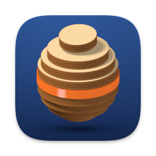
</p>

# Refab Artist

Refab Artist turns a 3D model into flat parts you can cut on a laser cutter or
CNC router, or by hand, and shows you how to put them back together. It also
has a set of tools for 3D printing: splitting a model into printable pieces,
making casting molds, adding lattices and supports, and repairing broken
meshes.

It is a native Mac app for Apple silicon, for makers, makerspaces, classrooms
and small fab shops who build objects from sheet material such as plywood,
MDF, acrylic or cardboard, or who 3D print and cast their own work.

The **[user guide](https://peterkatz.github.io/refab-artist/)** walks through
installing the app and building with each mode.

Version 0.1.0 is the first release. Read the [release notes](docs/releases/0.1.0.md)
for what is in it, what is experimental and what is known not to work yet.

## How it works

1. Open an STL or OBJ model.
2. Pick a construction technique (a "mode") and set your material: thickness,
   slot offset for your cutter's kerf, and sheet size. Presets cover common
   plywood, acrylic and cardboard.
3. Press **Slice** (or **Generate**, for the modes that build a mesh). The 3D view shows
   the parts, the cut sheet view shows how they are laid out on your sheets, and
   the assembly steps say what goes where.
4. Export the cut sheets as DXF, SVG, PDF or EPS, or the parts as STL or OBJ.
   You can also print the sheets, export an assembly guide and save the whole
   setup as a project file.

## Construction modes

### Flat parts for cutting

| Mode | What it does |
|---|---|
| **Stacked** | Cuts the model into parallel layers along X, Y or Z. Each layer becomes flat parts you glue up in order. Optional dowel holes line the stack up, red guide lines show where the next layer sits, and every part is numbered. |
| **Interlocked** | Cuts the model with two families of slices at right angles and carves half-lap slots where they cross, so the parts slide together into a grid without glue. Slot width follows your material thickness and slot offset; optional dog-bone relief rounds the slot corners for a router bit. |
| **Radial** | Builds the model from rings stacked along the vertical axis and fins fanned around its centre. Every place a ring and a fin cross gets a half-lap joint. |
| **Curve** | One family of parallel slices plus a second family of ribs that stand along a curve you shape, each perpendicular to it. Half-lap slots join the two families. |
| **Folded** | Unfolds the surface of the model into flat nets with fold lines, and adds tabs, slots and other joints to the edges that have to be joined. Cut a net out, fold it and join the edges. Suited to card and thin sheet. |

### 3D-printing and casting tools

These modes write meshes (STL or OBJ), not cut sheets.

| Mode | What it does |
|---|---|
| **3D Slices** | Cuts the model into layers that keep its real 3D surface, so the result is a layered mesh to print, in bands that peel apart. |
| **Structures** | Builds lattice-like geometry from a model: infill patterns (grids, cubic and octet lattices, gyroids and more), supports for overhangs, or a strut or perforated skin over the surface. You press **Generate**; nothing is recomputed while you move sliders. |
| **Partition** | Splits a model into watertight pieces with locating pins or keys at every seam. **Fit Printer** makes pieces that fit your build volume, automatically or with cut planes you place and angle in the viewport. **Split by Undercuts** makes pieces that can be moulded. Exports separate STL files, a named OBJ or a laid-out plate, with an assembly map. |
| **MotherMold** | Builds a 3D-printable casting mold around a model, in two or four keyed, flanged parts, with a pour spout and air vents. **Silicone mold + shell** makes a rigid mother mold that holds poured silicone; **Rigid mold** makes a mold whose cavity matches the model for direct casting. |

### Experimental

| Mode | What it does |
|---|---|
| **Inflatables** | Plans flat panels and seams for an inflatable sculpture. The panels are written as cut sheets, and the inflated shape as STL or OBJ. Hidden until you turn on **Show experimental modes** in Settings. |

### Model repair

The **Modify Form** tools in the Object inspector work on the whole model
before you slice it, without changing your imported file:

- **Make Watertight** closes a broken model. It first diagnoses the model and
  marks each problem in the 3D view. **Fix in place** repairs only the problem
  spots and caps each opening, leaving every other triangle exactly as it was.
  **Make walls** gives an open skin real walls. **Rebuild as solid** rebuilds the
  whole surface as one solid, for badly damaged scans.
- **Hollow** turns a solid model into a shell with the wall thickness you
  choose. **Thicken** grows every face outward.

### Also included

- Material and sheet presets, with kerf and slot offsets and a tool diameter.
- Slice Direction: tilt the cut away from the model's axes without turning the
  model.
- Dowel placement for Stacked, editable in the 3D view.
- Assembly steps that highlight each part in the 3D view, and a printable
  assembly guide.
- Project files (`.refabartist`) that save every setting.
- Optional support for a 3Dconnexion SpaceMouse (needs the 3Dconnexion driver).

## What the output looks like

Each picture below is drawn from the files Refab Artist exports: the cut sheet
from the SVG, the assembled model from the OBJ. They come from the project's
own test models.

<table>
  <tr>
    <th width="50%">Cut sheet</th>
    <th width="50%">Assembled</th>
  </tr>
  <tr>
    <td colspan="2"><b>Stacked</b>: a 50 mm sphere in 3 mm stock, 16 layers.</td>
  </tr>
  <tr>
    <td>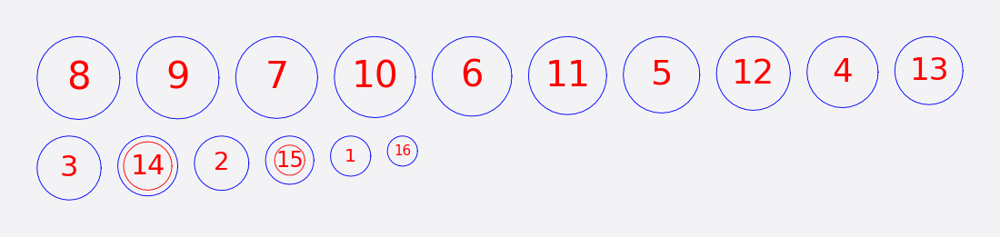</td>
    <td>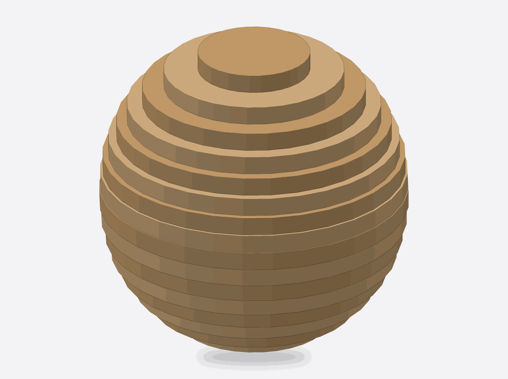</td>
  </tr>
  <tr>
    <td colspan="2"><b>Interlocked</b>: a small chair from slotted planks.</td>
  </tr>
  <tr>
    <td>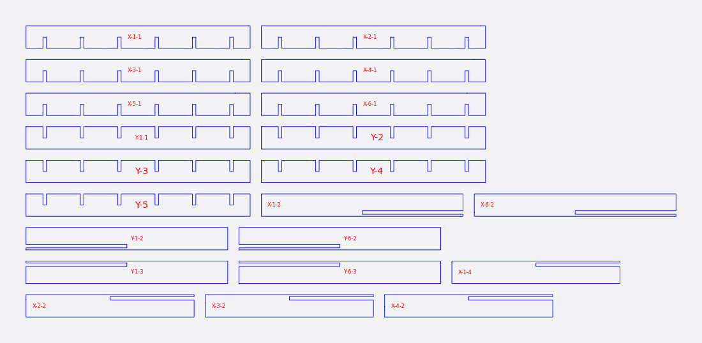</td>
    <td>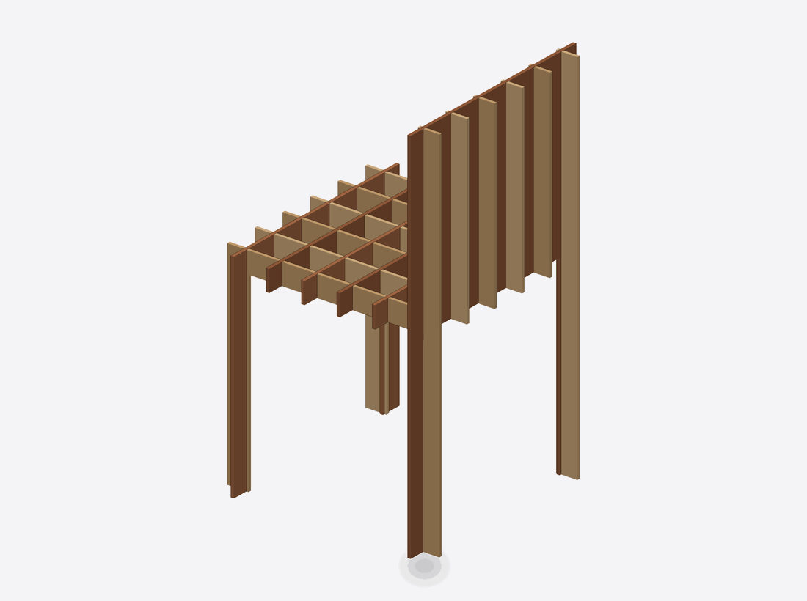</td>
  </tr>
  <tr>
    <td colspan="2"><b>Radial</b>: a torus from rings and fins.</td>
  </tr>
  <tr>
    <td>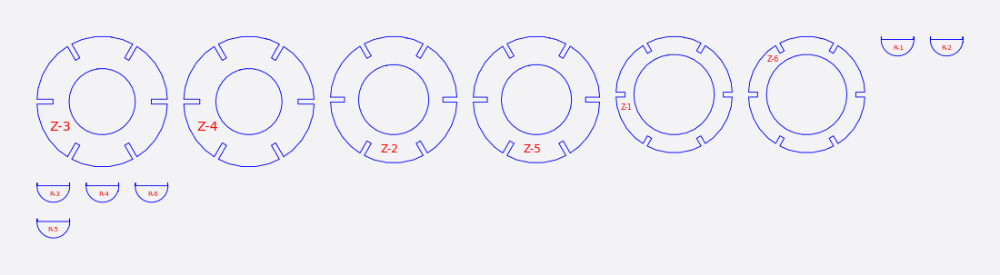</td>
    <td>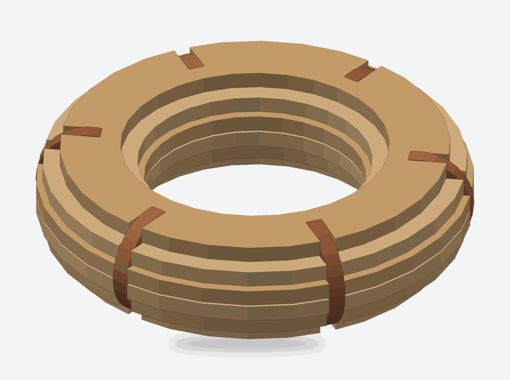</td>
  </tr>
  <tr>
    <td colspan="2"><b>Curve</b>: an organic blob with ribs along a curve.</td>
  </tr>
  <tr>
    <td>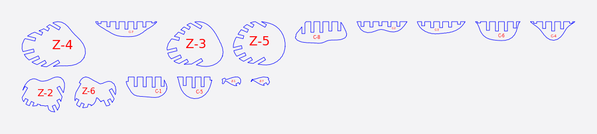</td>
    <td>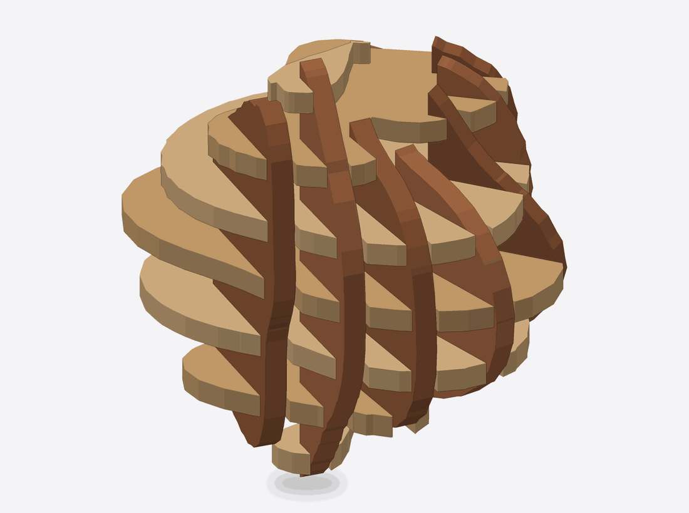</td>
  </tr>
  <tr>
    <td colspan="2"><b>Folded</b> (the cut sheet shows the flat nets, dashed lines are folds) and <b>3D Slices</b> (a layered mesh, no cut sheet).</td>
  </tr>
  <tr>
    <td>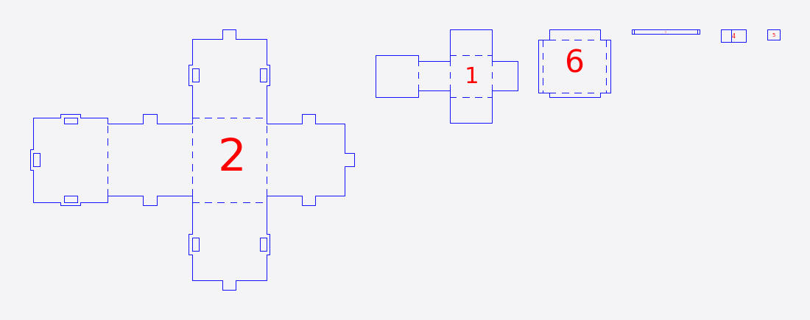</td>
    <td>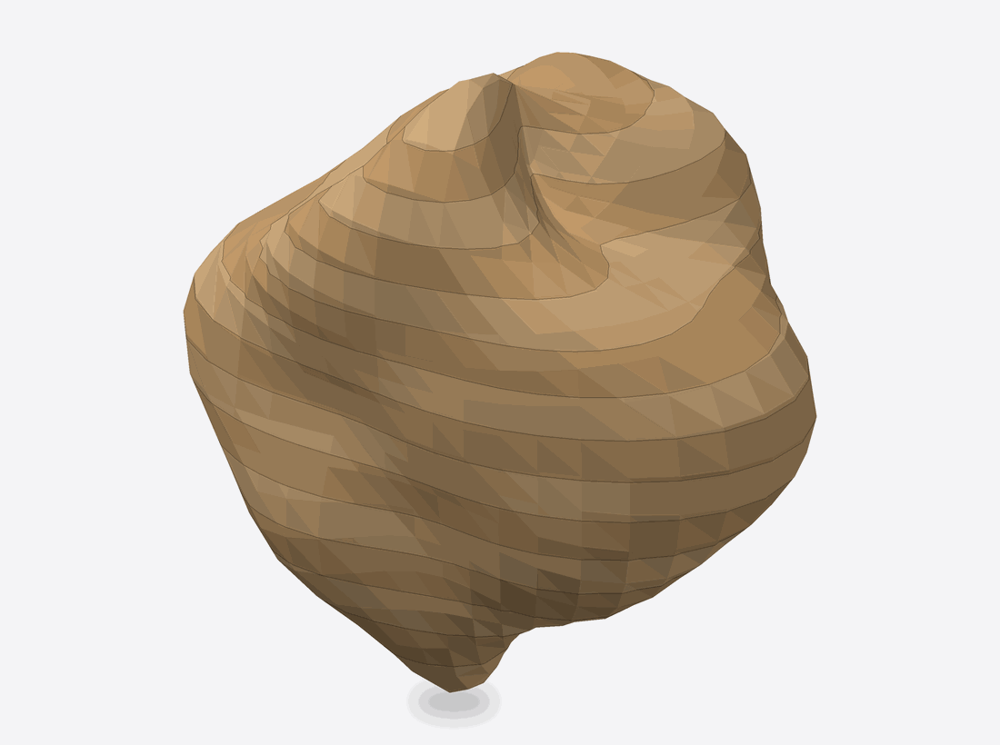</td>
  </tr>
</table>

<!--
  UI screenshots: none are included yet. To add some, save them in docs/images/
  (for example docs/images/app-window.png) and add an image line here, above
  "What the output looks like". The images above are made by
  tools/render_doc_images.py; do not overwrite them with screenshots.
-->

## System requirements

- A Mac with Apple silicon (M1 or later). Intel Macs are not supported.
- macOS 15 (Sequoia) or newer. The app is built and checked on macOS 26.
- To build from source: Xcode with a Swift 6 toolchain.

## Download

Download the app from the
[GitHub Releases page](https://github.com/peterkatz/refab-artist/releases). The
app is signed with a Developer ID and notarized by Apple, so it opens like any
other app: unzip it and drag **Refab Artist** to your Applications folder.

## Build from source

You need a Mac with Apple silicon, macOS 15 or newer, and Xcode (or its command
line tools) with Swift 6. Manifold and Clipper2 are vendored as prebuilt static
libraries, so nothing else needs installing.

```sh
git clone https://github.com/peterkatz/refab-artist.git
cd refab-artist

# Build an app you can double-click (a release build; the first one takes a few minutes):
tools/package_app.sh
open "build/Refab Artist.app"
```

`tools/package_app.sh` builds in release configuration and writes
`build/Refab Artist.app`, signed ad hoc so it runs on your Mac. It builds in
`/tmp/refab-artist-build`, so the app holds no path of your machine. To build
or run without packaging:

```sh
swift build --package-path app/RefabArtist -c release
swift run --package-path app/RefabArtist RefabArtist
```

The release build from `swift build` can also export without opening the
window. This writes a cut sheet for a small chair:

```sh
app/RefabArtist/.build/release/RefabArtist --headless-export \
  --mode interlocked --format svg --thickness 3 --slice-count 6 \
  --fixture tests/fixtures/real-world/simple_chair.stl \
  --output chair.svg
```

[docs/development.md](docs/development.md) lists the modes and options.

## Run the tests and checks

The Python tools need a few packages:

```sh
python3 -m pip install -r tools/requirements.txt
```

Then, from the repository root:

```sh
swift test --package-path app/RefabArtist   # the Swift test suite; about 45 minutes
python3 -m pytest -q                        # the Python tests
python3 scripts/functional_gate.py          # can the exported parts be cut?
python3 scripts/assembly_gate.py            # can the cut sheet be assembled?
python3 scripts/radial_geometry_gate.py     # checks on organic scanned models
```

The two gates are the project's definition of "done" for a cut-sheet mode:

- The **functional gate** checks that every part fits its sheet, parts do not
  overlap, every cut is a closed shape, holes and slots stay inside the
  material, and slots are as wide as the stock
  ([docs/functional-gate.md](docs/functional-gate.md)).
- The **assembly gate** checks that no slot cuts a part in two and no part is
  left unattached or too big for the sheet.

There is no cloud CI; the checks run on your machine. The assembly gate needs a
built binary (`swift build --package-path app/RefabArtist` first).

These checks show that the files are consistent and cuttable. They do not show
that parts fit in your material. No physical cut test has been recorded for
0.1.0 (see the [release notes](docs/releases/0.1.0.md)), so cut a small test
piece in your own stock first and adjust **Slot Offset** until the joints fit
([docs/physical-calibration.md](docs/physical-calibration.md)).

## How it is built

- Mac app: SwiftUI, in the Swift package at `app/RefabArtist/`.
- 3D viewport: RealityKit.
- 3D mesh operations: [Manifold](https://github.com/elalish/manifold), vendored
  as a static library.
- 2D polygon operations: [Clipper2](https://github.com/AngusJohnson/Clipper2),
  linked through Manifold.
- The cut-sheet modes and 3D Slices are specified in [docs/specs/](docs/specs/),
  one file per mode, next to the export, preset, assembly-step and UI specs.
  The other modes have no spec there yet; their requirement documents describe
  them: Structures in [docs/prd-structures-v2.md](docs/prd-structures-v2.md);
  Partition in [docs/prd-partition-construction-mode.md](docs/prd-partition-construction-mode.md)
  and [docs/prd-partition-split-by-undercuts.md](docs/prd-partition-split-by-undercuts.md);
  MotherMold in [docs/prd-mothermold-construction-mode.md](docs/prd-mothermold-construction-mode.md),
  [docs/prd-mothermold-reusable-tooling.md](docs/prd-mothermold-reusable-tooling.md)
  and [docs/MOTHERMOLD_CONTRACT.md](docs/MOTHERMOLD_CONTRACT.md); Inflatables in
  [docs/prd-inflatables.md](docs/prd-inflatables.md); Model Repair in
  [docs/prd-model-repair.md](docs/prd-model-repair.md).

## Contributing

Contributions are welcome. [CONTRIBUTING.md](CONTRIBUTING.md) explains how to
build and check a change, and the contributor agreement every contribution is
made under: you sign it once, by posting a comment on your first pull
request.

## Licence

Copyright (C) 2026 Pete Katz. Refab Artist is released under the GNU General
Public License, version 3; see [LICENSE](LICENSE). Vendored third-party
components keep their own licences; see
[THIRD_PARTY_NOTICES.md](THIRD_PARTY_NOTICES.md).
