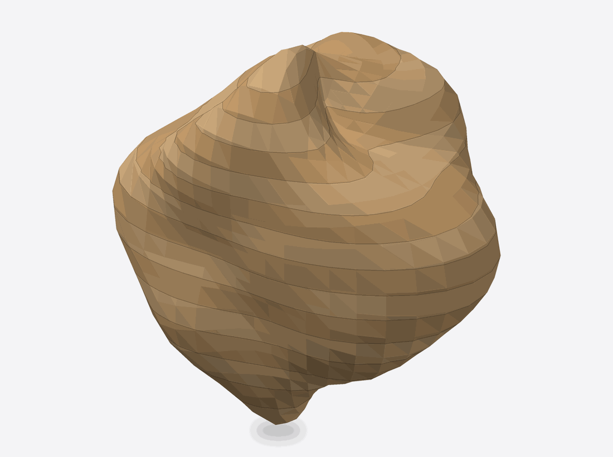

# 3D Slices

3D Slices cuts the model into contiguous layers along one axis, and each layer **keeps the model's real 3D surface** on its side walls. Stack the layers and you rebuild the model as peel-apart bands. The result is a printable **layered mesh**. There is no flat cut sheet.

It is Stacked with true side walls: Stacked extrudes each cross-section straight up into a flat plate, while 3D Slices keeps the surface between the cuts.

<figure markdown>

<figcaption>A layered mesh of an organic blob, in bands about 4 mm deep.</figcaption>
</figure>

## When to use it

- You want to 3D print a model in layers that can be separated, painted or assembled one band at a time.
- You want a layered look in print without cutting sheet material.

For flat parts you cut from sheet, use [Stacked](stacked.md).

## Controls that matter

- **Slice depth** (0.5 to 100 mm, 10 to start with): the spacing between layers.
- **Distribute count** (1 to 240): turn it on to choose an even number of layers instead; this overrides and greys out Slice depth.
- **Slice Direction:** tilt the cut away from vertical.

3D Slices builds a mesh, so it has no Manufacturing Settings: stock, slots and sheets do not change it, and the section is not shown.

## What you get

- STL or OBJ only. The layers tile the whole model with no gaps; the model's own top and bottom surfaces close the first and last bands.
- Assembly steps place the bands from the bottom up, and the printable assembly guide shows the slice depth (or layer count) in place of a material thickness.
