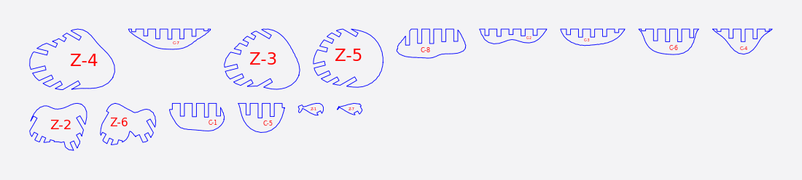
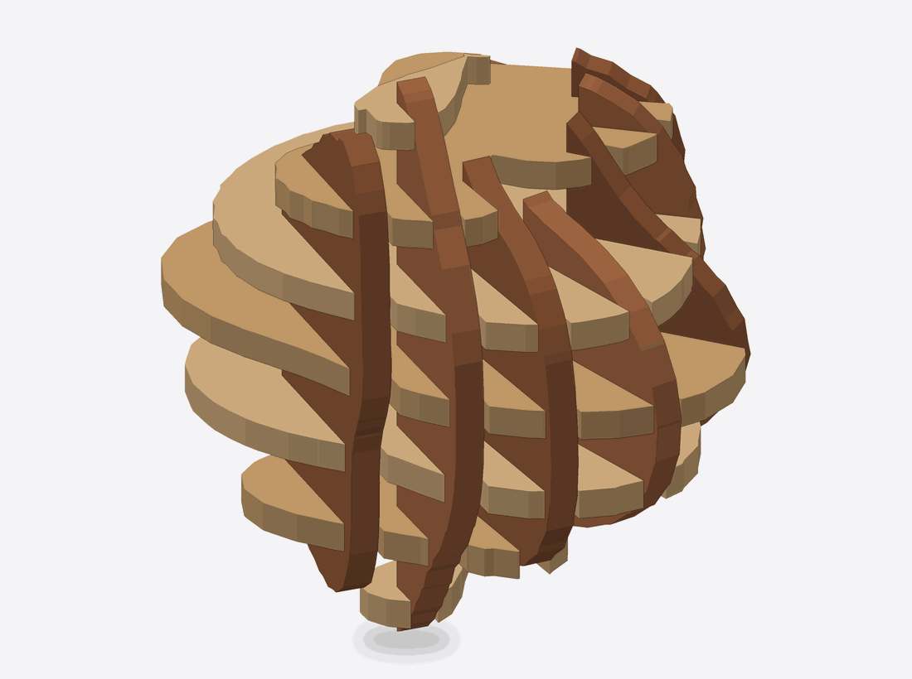

# Curve

Curve is a two-family interlocking mode whose second family follows a curve. The first family is a set of parallel slices (the **first-axis ribs**). The second is a set of vertical ribs standing along a curve you shape, each one perpendicular to it (the **curve ribs**). Half-lap slots join the two families where they cross.

<figure markdown>

<figcaption>The cut sheet: slice outlines and ribs for an organic blob.</figcaption>
</figure>
<figure markdown>

<figcaption>Slices crossed by curved ribs, in place.</figcaption>
</figure>

## When to use it

- Your model bends or sweeps: a tail, a handle, a wave, a figure with a lean.
- You want the cross-ribs to fan out where the shape curves, so the structure follows the form instead of a straight grid.

## Controls that matter

- **1st Axis:** the axis of the first family.
- **1st Axis slices:** how many first-axis ribs you want (1 to 72). The mode cuts fewer when that many would not fit with a web of material at least as thick as the stock left between slots. A note in orange under the control tells you when that happens and why.
- **Curve slices:** how many curve ribs you want (2 to 72), with the same behaviour.
- **Amplitude:** how far the default curve bows, in mm (10 to start with), at most the model's extent along it.
- **Thickness** and **Slot Offset:** set slot width. Turn on **Notch width** if you want to type a width directly; it replaces them.

Curve slots are cut square, and Curve cuts no relief, so Tool Dia. is not shown.

## What you get

- Parts are `first_axis_NNN` and `curve_NNN` in the exports; each is a labelled cut-sheet part.
- Assembly steps place the first-axis ribs, then insert the curve ribs.
- Parts the joints hold together but not to the rest of the model are shown in blue on the cut sheet, meaning glue them in place.

## Tips

- If a note says a first-axis rib has been "set off the even spacing", the mode moved it so the joints hold parts that would otherwise be joined only to each other. This is expected.
- Where the curve bends sharply, the curve ribs stop short of the concave side, so that side is held by the first-axis ribs alone.

## Known limits

- On some organic models with the first axis set to Y and 5 mm stock, a few parts are marked to be glued in place instead of being held by joints. Another first axis, fewer curve slices or thinner stock join them.
- A first-axis rib moved to join parts can leave a small lip near flat faces.
