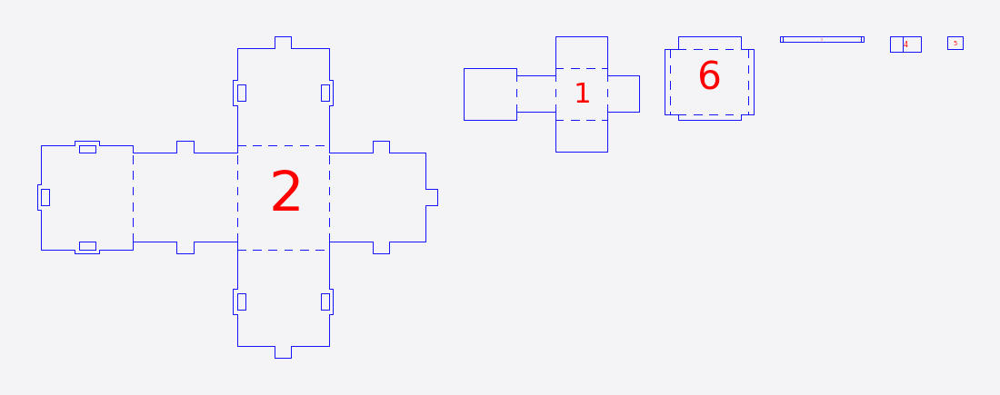

# Folded

Folded does not slice. It treats the model's surface as a set of flat **panels**, unfolds them into one or more flat **nets** hinged along fold lines, and adds tabs, slots and other joinery to the edges that have to be joined again. Cut a net out, fold it along its fold lines and join the cut edges, and the model rebuilds as a shell.

<figure markdown>

<figcaption>The cut sheet for a low-poly head. Dashed lines are folds.</figcaption>
</figure>

## When to use it

- You want a hollow, lightweight paper-craft style model from card or thin sheet.
- Your model is faceted (low-poly) or can be simplified to a modest number of faces.

Folded assumes your stock **bends** at the fold lines: card, thin sheet, or a perforated or kerf-cut crease. In stiff stock the fold lines must be cut through and the panels glued.

## Controls that matter

- **Joint Type:** the joinery on the cut edges. The choices are None, Diamond, Gear, Laced, Multitab, Puzzle, Rivet, Tab, Ticked and Tongue, and Diamond is the starting choice. Choosing one loads sensible defaults for its size and spacing, and shows that joint's own size and spacing controls. Laced and Ticked fit nothing into a slot, and None cuts no slots, so Slot Offset is greyed out for those.
- **Detail** (12 to 2000 faces, default 250), in the **Simplify Form** group: the polygon budget. Models with more faces are simplified to this number first, so every remaining face becomes a panel. Lower Detail gives fewer, bigger panels and an easier build. **Vertex Count** and **Face Count** beside it show the same budget.
- **Perforate:** on by default; draws fold lines as perforation dashes (cut) instead of scored lines.
- **Split Panels:** makes the nets smaller so they fit a smaller sheet. Disabled when every net already fits in half a sheet.
- **Edit seams:** under **Add/Remove Seams**. While it is on, click a panel edge in the 3D view to force a cut there rather than a fold. **Seams** counts them and **Clear** removes them all.
- **Thickness** and **Slot Offset:** the stock, and the clearance added to every slot a tab passes through.

Folded has no Slice Direction. Dense meshes are not refused; Folded builds a simplified shape around the object and lays that out.

## What you get

- Each net is one cut-sheet part. Fold lines are on their own layer (red when scored, blue when perforated).
- Assembly steps are "Fold folded_panel_NNN", one per panel.
- The mode tells you when some panels are left out or cut back because their neighbours' stock already occupies their space, for example "3 of 172 panels are left out". Thinner stock or a lower Detail keeps more of them.

## Tips

- Start with a low Detail (the default is a good start) and a thin stock.
- On curved models most edges are left plain to glue or tape.

## Known limits

- Assembly step numbers count panels, while the cut sheet has one part per net, so step numbers differ from the sheet labels.
- The STL and OBJ export of the cut parts lays them flat at their unfolded positions rather than folded into place.
- The order in which parts can be assembled is not checked for Folded or Curve: a joint is checked where the parts end up, not that every part can be slid in turn.
