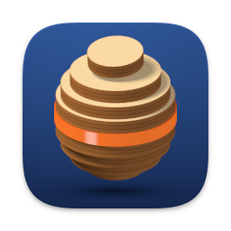
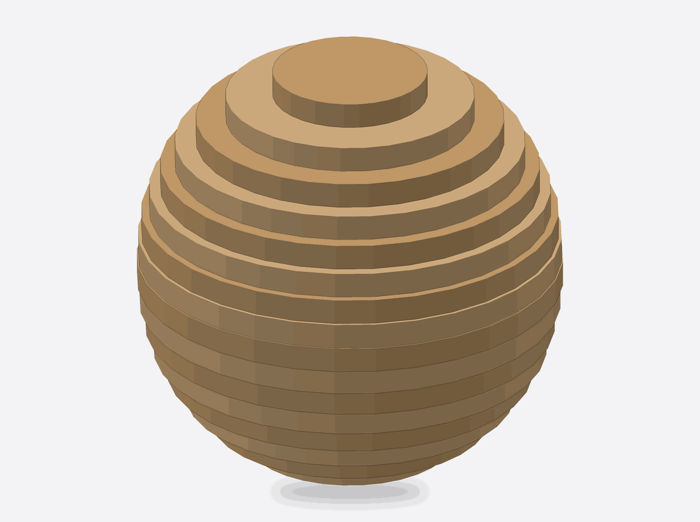
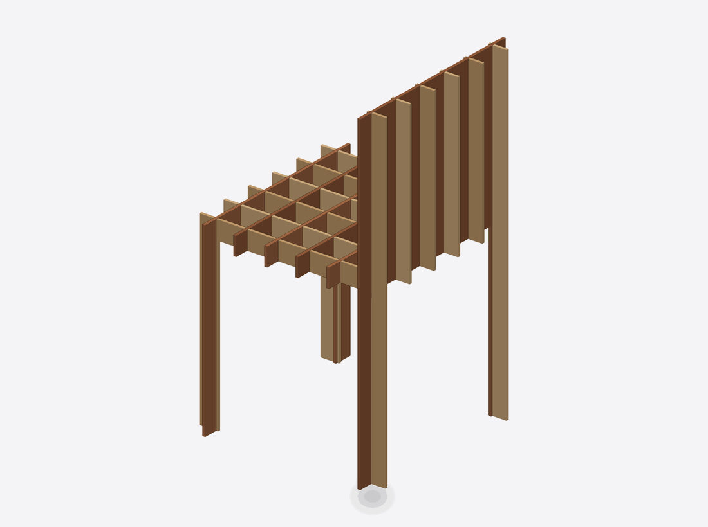
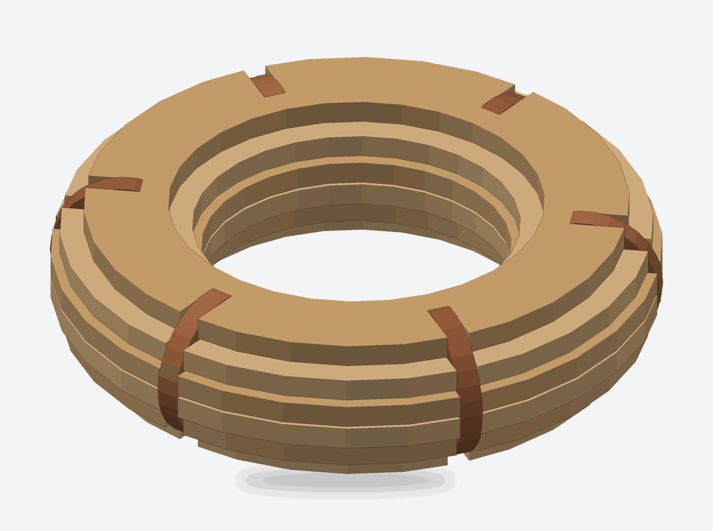
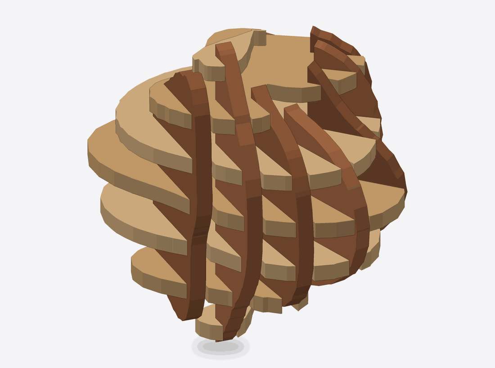
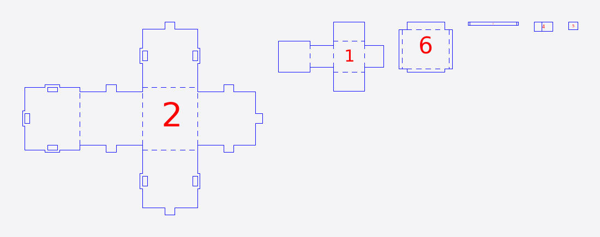
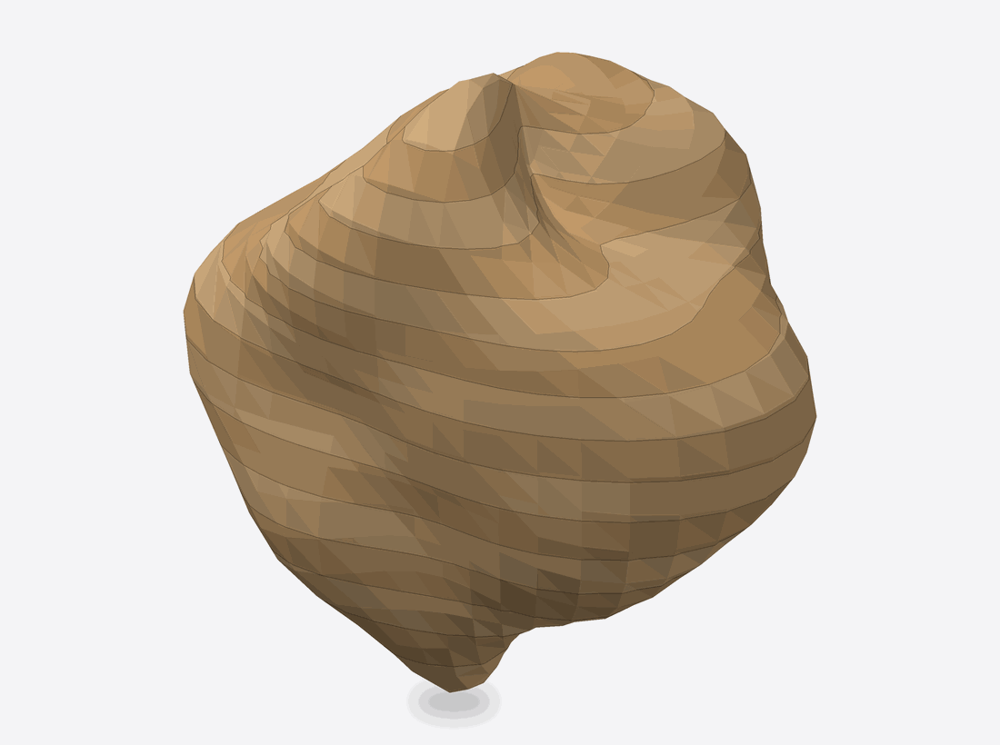
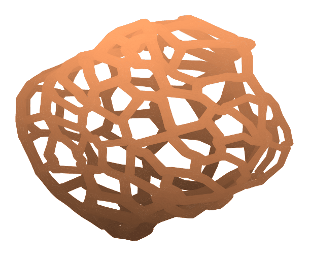
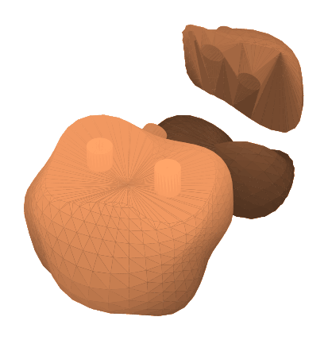
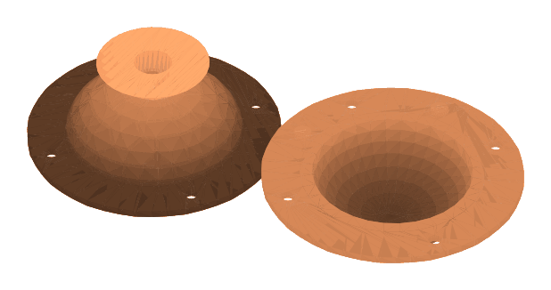

{ .ra-hero-mark alt="" }

# Refab Artist

Turn a 3D model into flat parts you can cut, with steps to put them back together.

[Download for Mac](https://github.com/peterkatz/refab-artist/releases){ .md-button .md-button--primary .md-button--big }
[Read the guide](install.md){ .ra-quiet }

For Apple silicon Macs running macOS 15 or later. Free and open source (GPL-3.0).

## What it is

Refab Artist is a Mac app for makers who build objects from sheet material. Open a 3D model, choose how you want to build it, tell the app what you are cutting from (plywood, MDF, acrylic, card), and it works out the flat parts, lays them out on your sheets, and numbers them. You export the sheets for your laser cutter or CNC router, or print them and cut by hand. The assembly steps then walk you through putting the parts together.

It also has a set of tools for 3D printing and casting: splitting a model into printable pieces, making casting molds, adding lattices and supports, and repairing broken meshes.

## Who it is for

- Makers with a laser cutter, a CNC router, a craft cutter or a good knife, who want to turn a sculpt or a scan into a physical object made of layers, ribs or folded card.
- Makerspaces, classrooms and small fab shops.
- People who 3D print and cast their own work and want help splitting, moulding and repairing models.

You do not need to know CAD. You do need a 3D model in STL or OBJ format.

## What each mode makes

### Stacked

Parallel layers along one axis. Cut them out, glue them up in order, and the model appears as a terraced solid. [More](stacked.md)

### Interlocked

Two families of slices with half-lap slots where they cross, so the parts slide together into a grid. [More](interlocked.md)

### Radial

Rings stacked up the model and fins fanned around its centre, notched together. [More](radial.md)

### Curve

One family of slices crossed by ribs that follow a curve you shape. [More](curve.md)

### Folded

The surface unfolded into flat nets with fold lines and joinery. Cut, fold and join. Best for card and thin sheet. [More](folded.md)

### 3D Slices

A layered mesh for 3D printing: layers that keep the model's real surface. [More](3d-slices.md)

### Structures

Lattice and pattern infill, supports, and strut skins, as printable meshes. [More](structures.md)

### Partition

Split a model into watertight pieces that fit your printer, with locating keys at every seam, or into pieces that can be moulded. [More](partition.md)

### MotherMold

A 3D-printable casting mold around your model, in keyed parts with a clamping rim, a pour hole and vents. [More](mothermold.md)

<small>These pictures are drawn from the files Refab Artist exports, using the project's own test models. They are illustrations of the output, not screenshots of the app window.</small>

## What you need

- A Mac with Apple silicon (M1 or later). Intel Macs are not supported.
- macOS 15 (Sequoia) or newer. Version 0.1.0 was built and checked on macOS 26.
- A 3D model as an STL or OBJ file.
- Sheet material and a way to cut it, for the cut-sheet modes. A 3D printer, for the mesh modes.

[Install Refab Artist](install.md){ .md-button }
[Getting started](getting-started.md){ .md-button }

!!! note "Version 0.1.0 is the first release"
    The checks run before each release show that exported files are consistent and cuttable. No parts have been cut and assembled in real material for this release, so cut a small test piece first. [Cutting and fit](cutting-and-fit.md) shows how.
