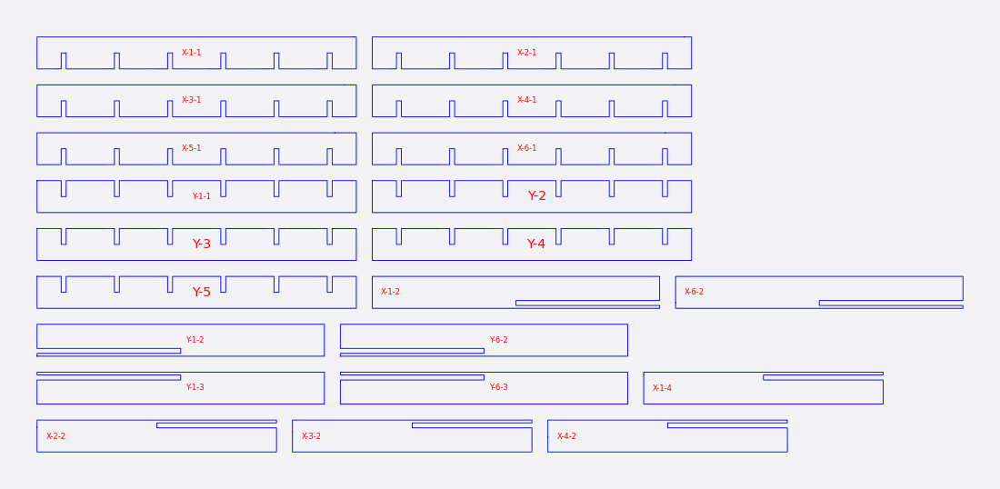
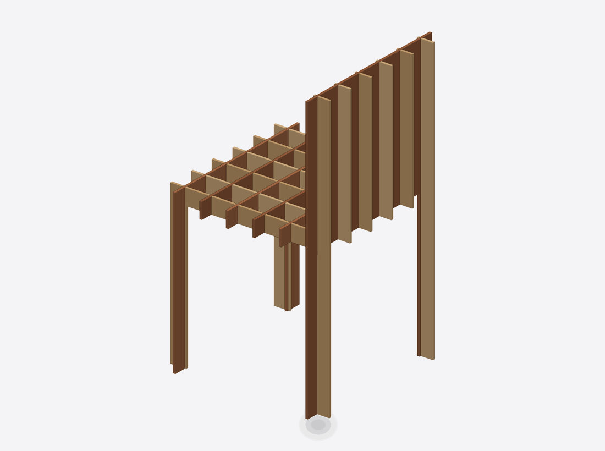

# Interlocked

Interlocked cuts the model with two families of slices at right angles and carves a half-lap slot wherever they cross. The parts slide together into a grid, so you can build the model without glue.

<figure markdown>

<figcaption>The cut sheet: slotted planks for a small chair.</figcaption>
</figure>
<figure markdown>

<figcaption>The two families in place.</figcaption>
</figure>

## When to use it

- You want a light, open "waffle" structure that holds together by its joints.
- Your model is reasonably compact. The grid works best on shapes you can imagine cut into planks.
- You have a laser or CNC router. Slot fit matters here, so plan a test cut.

## How the slices run

Both families are vertical planks laid across the model's **longest** side, so the longest axis is never a slicing direction. For a model that is clearly taller than it is wide, the planks run on X and Y; for one clearly longer in X, on Y and Z; and so on. The **Primary** and **Secondary** axis pickers only apply when all three sides are about equal (a cube or a sphere). Otherwise they are greyed out and the panel tells you which axes are in use.

## Controls that matter

- **Distribute count:** turn it on to choose how many **Slices** per family (1 to 240). Without it there are 10 per family, spread evenly. The count, not the stock thickness, sets the spacing.
- **Thickness** and **Slot Offset** (Manufacturing Settings): the slot is cut `thickness + slot offset` wide. This is the setting you tune with a test cut.
- **Notch width:** turn it on and type a slot **Width** directly. It replaces thickness plus offset, and Slot Offset is greyed out.
- **Slot angle:** flares the mouth of each slot (0 to 60 degrees) to make assembly easier.
- **Slot relief** and **Tool Dia.:** turn on Slot relief to add a round dog-bone relief at the inside corners of each slot for a router bit. It is cut for the **Tool Dia.** in Manufacturing Settings, the bit's diameter; leave that at 0 for a laser.
- **Slice Direction:** tilt the cut.

## What you get

- Each part is numbered with its family: `Z-6`, `Y-2`, or `Y-2-1` when a slice falls into several pieces.
- Assembly steps place all the primary parts first, then insert the secondary parts into their slots.
- STL and OBJ exports let you check the assembled grid.

## Tips

- If the planks are thick compared with the slice spacing, the slots can merge and each part loses its slotted half. Nothing warns you. Use **Distribute count** to space the slices further apart, or thinner stock.
- Parts that fit loosely? Lower Slot Offset. Parts that will not go together? Raise it. [Cutting and fit](cutting-and-fit.md) has a method.

## Known limits

- Interlocked exports carry no part positions, so the project's own checks confirm the slots are the right width and cuttable but cannot confirm that every pair of slots mates. A test cut matters.
- In the STL and OBJ export, slots are only cut into parts whose outline is a plain rectangle; other parts are exported without their slots.
