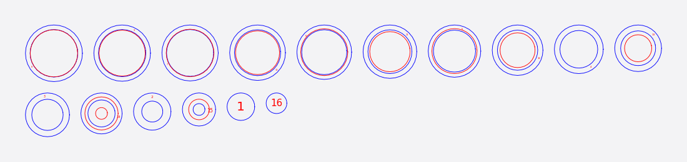

# Model repair

Scans and downloaded models are often not quite solid: they have holes, flipped faces or stray pieces. The **Modify Form** tools in the **Object** tab of the right inspector work on the whole model *before* you slice, without changing the file you imported. You can remove a tool at any time to go back to the imported mesh.

There are three tools: **Make Watertight**, **Hollow** and **Thicken**. Each has an eye button to preview its result in the 3D view and an **Apply** button to use it. The slice, the cut sheets and the exports then use the modified model.

!!! note "Closed, not perfect"
    "Watertight" here means closed: no holes. A healed organic scan can keep harmless self-contact edges, so the counts shown are real counts, not a promise of a perfect solid.

## Make Watertight

Closes a broken model. It begins by **diagnosing** the model: it measures the surface and marks each problem in the 3D view. Each opening is listed; click a row to see it in the view. There are three methods:

- **Fix in place** repairs only the problem spots and caps each opening, leaving every other triangle exactly as it was. Use it for a model that is nearly solid. For each opening you can choose to **Cap** it or **Leave open**, and give the cap a dish or dome shape.
- **Make walls** gives an open skin real walls. The outside stays exactly as modelled, the wall grows inward, and the rim stays open. Use it for a cup, a bowl or a vase that was modelled as a thin skin. You set the **Wall** thickness.
- **Rebuild as solid** rebuilds the whole surface as one closed solid, filling cavities. Use it for scans too damaged for the other two. **Detail** controls how fine it is; higher is finer and slower. Because it re-meshes the surface, it changes every triangle.

Try them in that order: the first changes the least.

## Hollow

Turns a solid model into a shell with the wall thickness you choose (0.5 to 30 mm). The outside looks the same; the inside is hollow. Because the shell is interior, the solid 3D view looks unchanged. The slice contours show it, as rings on the cut sheet in Stacked, for example.

<figure markdown>

<figcaption>A 50 mm sphere hollowed with a 4 mm wall, sliced in Stacked: each layer is a ring.</figcaption>
</figure>

Use Hollow to save material, or to build a model as a shell that is later filled.

## Thicken

Grows every face outward by the amount you choose (0.1 to 20 mm). It rescues thin details that would not survive cutting.

## Tips

- Check **Object Size** first: a repair at the wrong scale uses the wrong wall thickness.
- The **Issues** and **Stats** tabs show mesh health: open edges, non-manifold edges, degenerate faces and duplicates.
- Make Watertight can run under Hollow or Thicken when the model needs closing first.
