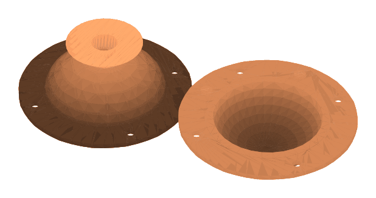

# MotherMold

MotherMold builds a 3D-printable casting mold around your model, in two or four keyed parts with a clamping rim to bolt them together, a pour hole and air vents. It writes meshes (STL or OBJ, or a ZIP or plate of them), not cut sheets.

<figure markdown>

<figcaption>A two-part rigid mold for a 50 mm sphere, laid out. One half has the pour funnel, the other the cavity. Both have the clamping rim with bolt holes.</figcaption>
</figure>

## What are you making?

The panel opens with three goals. Pick one first:

- **Cast copies** makes a rigid "mother mold" shell that holds poured silicone. You cast silicone around your master in the printed shell, then cast your final copies in the silicone. Silicone flexes off undercuts, so undercut detection is only informational here. This is the right choice for detailed sculpture and several copies.
- **Rigid mold** makes a hard printed mold whose cavity matches your model, for casting directly into it. Because the printed mold cannot flex, undercuts matter: the app checks that every part can be pulled away cleanly, and blocks export if it cannot prove it. It suits simple shapes and materials that release easily.
- **Production tooling** is for repeated production runs. It adds sections for the printed master and how it is held, and exports one manufacturing ZIP with the parts and their documents. Treat it as the most advanced choice.

## Controls that matter

- **Parts** (under **Split**): **2-part** or **4-part**. A four-part mold is cut by two planes.
- **Mode:** **Auto** or **Manual** parting. With Manual you choose each plane's **Axis** (X, Y or Z) and **Offset**. Auto uses two orthogonal planes for a four-part mold.
- **Wall** under **Shell:** the thickness of the mold wall. For Cast copies there are also **Silicone thickness** and **Detail softening**, which together set the **Total cavity offset** shown beneath them.
- **Flat floor** and **Floor:** a closed flat base, and its thickness.
- **Keys & clamping** (a folded section): **Type** of registration key (**None**, **Tapered round** or **Tapered bar**), with its size, **Depth**, **Fit clearance** and **Keys per seam**. The keys have a release taper so the parts separate easily, and the female pocket is sized with the clearance. Below them, **Clamping rim** adds a flange plate at the parts' meeting faces, with its **Width**, **Thick**, number of **Bolt holes** and **Bolt Ø**.
- **Pour & vents** (a folded section): **Pour hole** mode (**Auto** or **Manual**), **Pour hole Ø**, the number of **Vents** and **Vent Ø**.
- **Output** (a folded section): **Package** (for example separate STLs in a zip, a combined OBJ, or a single laid-out plate) and **Assembly guide**.

Press **Build mold** when you are ready. Nothing is built while you change settings.

The master model must be **watertight** (a closed shape). If it is not, the build tells you in plain words and points you at [Make Watertight](model-repair.md) before you go further.

## What you get

- Each mold part is checked to be a watertight, finite mesh.
- An **assembly guide** lists the parts, parting planes and steps: clean the casting faces, align and key the parts, clamp them with bolts, pour slowly through the funnel, let air out through every vent, cure, and open the mold. For Cast copies it begins with how the master is held while you pour.
- **Explode** in the 3D view pulls the parts apart so you can inspect the inside. Pressing it again restores the assembled view. Undercut markers can be switched on to show where the model would catch.
- Export is blocked if a requirement is not met, for example if the clamping rim does not cover every interface or a key is damaged, and the panel says why. The parts stay available for inspection.

## Tips

- With silicone, a printed fit is not a liquid seal. Seal the master's locating land with clay or a compatible sealant before you pour.
- Check bed fit and supports in your own printer software; MotherMold verifies the mold geometry, not your print.
- A small mold may not fit the default 12 mm pour funnel. Choose a smaller **Pour hole Ø**.

## Known limits

Some combinations are known not to build in 0.1.0; see [Troubleshooting](troubleshooting.md):

- a four-part reusable silicone mold on some models (a head-shaped test model stops while placing the liner registration buttons),
- a four-part mold of a scanned hand with X and Z planes through its centre,
- the funnel and a very small mold.
