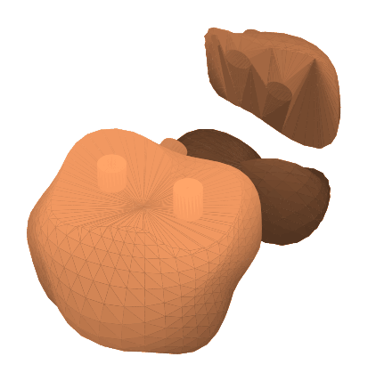

# Partition

Partition splits a model into watertight pieces. In Fit Printer it also adds locating keys at every seam, so the printed pieces line up when you glue them. It exports meshes (STL or OBJ), not cut sheets.

<figure markdown>

<figcaption>An organic blob split to fit a 60 mm build volume, shown laid out. The pins on the cut face fit sockets in the next piece.</figcaption>
</figure>

## Two purposes

A **Purpose** picker at the top of the panel chooses what Partition is for.

### Fit Printer

Use this when the model is bigger than your printer.

1. Pick a **Printer** preset from the list (Bambu Lab X1C, A1 and A1 mini, Prusa MK4, Creality Ender-3 and others), or choose Custom and enter a build volume (**W**, **D** and **H**).
2. Set the **Bed margin**, the space to keep clear at the edge of the bed.
3. Under **Splitting**, choose **Auto-fit** or **Manual**. Auto-fit works out the cuts that make every piece fit, and offers a **Strategy**: fewest parts, or even part sizes. Manual lets you add cut planes (**Add X**, **Add Y**, **Add Z**) and move and angle them in the 3D view yourself. **From Auto-fit** seeds the planes from the automatic result, so you can auto-fit first and then adjust by hand.
4. Under **Seams & keys**, choose a **Key**: locating pins (pin and socket), a rectangular wedge key, or none for a plain butt joint. The key size, length and tolerance are adjustable.
5. Press **Generate**. Splitting a dense model takes a moment and runs in the background. A **Fit check** shows how many pieces there are and whether they all fit.

### Split by Undercuts

Use this to make pieces that can be moulded: it divides a watertight model into a small number of pieces that can each be pulled free of a mold. You set the **Undercut tolerance**, the **Pull policy** (Automatic, or Fixed to a direction you choose), the **Max pieces**, and a **Priority** (Fewer pieces, Balanced or Cleaner seams). A **Search quality** setting (Quick, Standard or Thorough) is under the advanced settings. Planning can run for a while, and you can cancel it; pieces from the previous run are kept.

!!! warning "Check scanned models yourself"
    The undercut measurement is tested on simple shapes and on scans, and the split itself is tested on simple shapes. The tests that split a scanned hand and an open mask do not run yet. On an organic scan, inspect every piece in the 3D view before you make a mold from it. Fit Printer is not affected.

## Export

Partition writes:

Fit Printer offers three **Packaging** choices:

- **Separate files in a .zip**, one STL per piece;
- **One file, named parts**: a single OBJ with a named object per piece;
- **Laid out on one plate**: all the pieces placed on a single plate.

**Naming** chooses grid labels (A1, B2...) or sequential names (part-01...). **Include assembly map** adds a map saying which piece joins which. Split by Undercuts exports as STL or OBJ from the Export section.

## Tips

- Make the model watertight first if it is a scan; see [Model repair](model-repair.md).
- Pieces stay solid. Partition does not hollow or thicken them.
- Pieces are checked as watertight meshes. Printer settings (supports, temperatures, speeds) stay with your slicing software.
