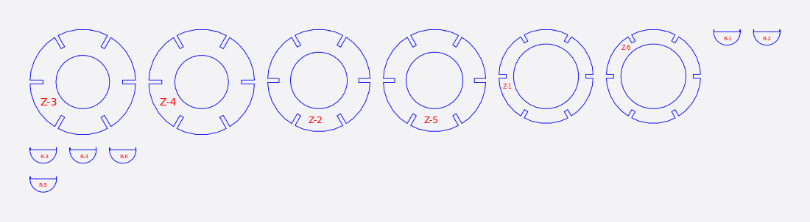
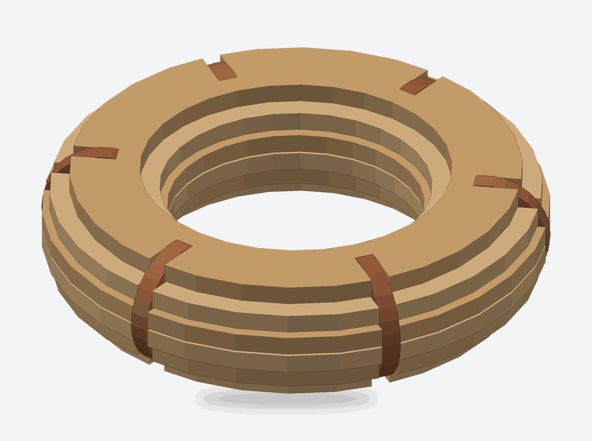

# Radial

Radial builds the model from **rings** and **fins**. The rings are a stack of cross-sections along the vertical axis. The fins are vertical sections fanned around the model's centre like the segments of an orange. Wherever a ring and a fin cross there is a half-lap joint, a notch in the ring and a slot in the fin, so the two families lock together.

<figure markdown>

<figcaption>The cut sheet: notched rings and fins for a torus.</figcaption>
</figure>
<figure markdown>

<figcaption>The rings and fins in place.</figcaption>
</figure>

## When to use it

- Your model is round or roughly turned: a vase, a bust, a helmet, a lamp shade.
- You want the structure to read as rings at every height, with fins giving it stiffness.

Rings are always cut across the **vertical (Z) axis**, whatever the model's proportions, so stand the model up first.

## Controls that matter

- **Method:** *By Count* or *By Distance*, with the matching **1st Axis** value: the number of rings (1 to 72, 10 to start with), or the spacing between them in mm. Rings are never closer than one stock thickness, so you may get fewer than you asked for.
- **Radial (Count):** how many fins, 1 to 72 (6 to start with).
- **Thickness** and **Slot Offset:** set the width of every notch and slot.
- **Relief Type:** *Square*, *Horizontal*, *Vertical* or *Dog Bone*. Relief rounds out the inside corner of each notch so a router bit can reach it. It is cut for **Tool Dia.** in Manufacturing Settings, which is greyed out for Square relief because square cuts no circles.
- **Notch Angle** is shown but disabled: radial notches are always cut square.

## What you get

- Parts are numbered `first_axis_NNN` for rings and `radial_NNN` for fins in the exports.
- Assembly steps place the rings from the bottom up, then insert the fins.
- A ring piece that no fin reaches is left out, and the notes name it.

## Tips

- Asking for 8 fins currently gives 10. See [Troubleshooting](troubleshooting.md).
- Pieces that meet the other family only where a line crosses the model more than once are marked to be glued, not locked.
- Use dog-bone relief with a CNC router; a laser does not need it.
