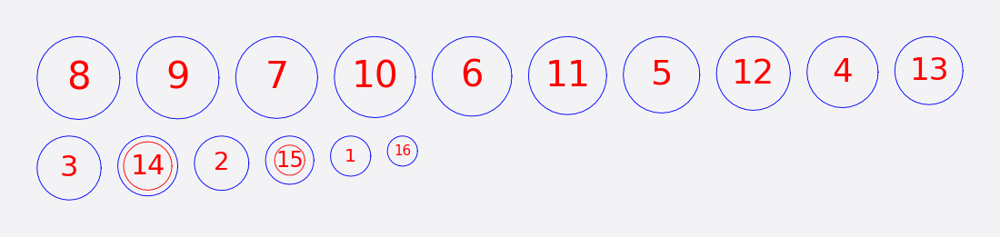
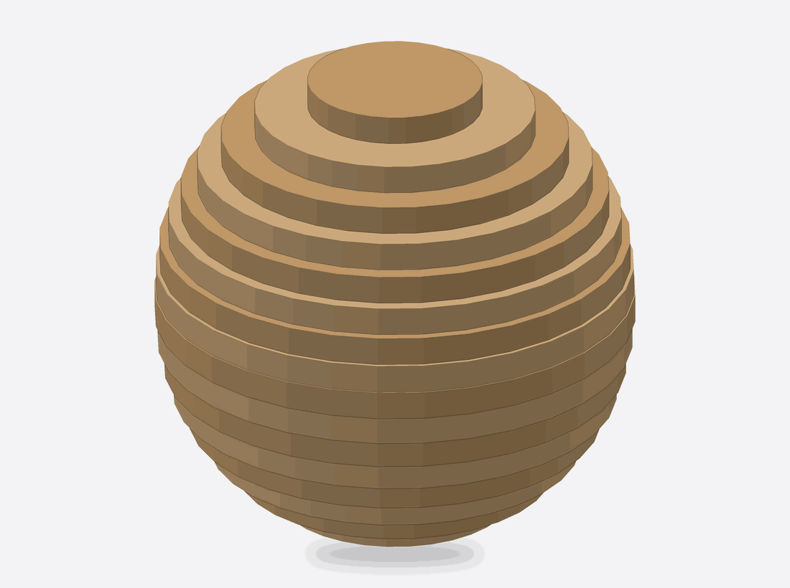

# Stacked

Stacked cuts the model into parallel layers along one axis. Each layer becomes flat parts. Glue the parts up in order and the model rebuilds as a terraced solid. It is the simplest mode and the easiest place to start.

<figure markdown>

<figcaption>The cut sheet: a 50 mm sphere in 3 mm stock, 16 numbered layers.</figcaption>
</figure>
<figure markdown>

<figcaption>The same layers in place.</figcaption>
</figure>

## When to use it

- You want a solid-looking sculpture, a bust or a vase from sheet material and don't mind the stepped surface (or plan to sand it).
- You want parts that need no slots or joinery, only glue.
- A layer that falls into several separate pieces is fine: each piece becomes its own labelled part.

Choose Interlocked or Radial instead if you want a lighter, open structure that holds together without glue.

## Controls that matter

- **Primary:** the axis the layers are stacked along: X, Y or Z. The layers are drawn in the plane of the other two axes. Stand the model up first (in Object Size) if you want the layers to run a particular way.
- **Thickness** (Manufacturing Settings): the real thickness of your stock. With automatic distribution it is also the spacing between layers.
- **Method:** *Automatic* spaces the layers one thickness apart, centred on the model. *By Count* gives you exactly that many **Slices** (1 to 240); *By Distance* a **Spacing** you choose. *Custom* lets you place each layer yourself: turn on **Edit Slices**, click a layer in the 3D view and drag it along the axis, use the add and delete buttons, or press **Distribute Evenly** to start over.
- **Dowel holes** (their own **Dowels** section, below Slice Direction): turn on to cut matching holes through every layer so a rod threads the stack and keeps it lined up while the glue dries. Choose the **Shape** (Square, Pencil, Round, Cross, Horizontal Slot or Vertical Slot), the **Diameter** and the **Inset**. The **Automatic** button stands rods where they pass through the most layers, and the number beside it says how many. Switch on **Edit placement** and click the sliced model to add a rod, drag one to move it through the whole stack, and press Delete to remove it.
- **Slice Direction:** tilt the layers away from the axis.

Stacked does not use Slot Offset or Tool Dia., so those rows are not shown.

## What you get

- Every part is numbered. Digits 6 and 9 carry an underline so you can tell them apart when a part is turned.
- Red **scored guide lines** inside each part show where the next layer sits, so you can line it up while gluing.
- The assembly steps are one per layer, in order: "Place slice_001", then 002, and so on.

## Tips

- Thinner stock gives a smoother surface and more parts. Check the part count before you commit to a big job.
- Use dowels on anything taller than a handful of layers. Without them the stack can drift.
- The STL and OBJ export shows the assembled result, so you can check the look in another viewer before cutting.

## Known limits

- When dowels are switched off, a layer with a hole in it exports to STL/OBJ with the hole filled. Turn dowels on, or treat the mesh as a rough preview.
- The EPS export for Stacked lays the parts out in rows and is drawn mirrored top-to-bottom compared with the SVG and PDF; use SVG, PDF or DXF for cutting. See [Exporting](exporting.md).
