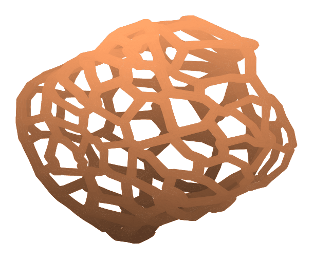

# Structures

Structures builds lattice-like geometry from a model, as a printable mesh (STL or OBJ). It has three types, chosen with the **Type** picker: **Infill**, **Supports** and **Skin**.

<figure markdown>

<figcaption>Skin: the surface of an organic blob replaced by a network of struts.</figcaption>
</figure>

## How it works

Structures has its own **Generate** button (it reads **Re-generate** afterwards). Nothing is recomputed while you move sliders; press it when you are ready. The work runs in the background, and the 3D view shows exactly the geometry that will be exported. If you change a setting after generating, the old result is hidden until you generate again.

Structures, like the other mesh modes, has no cut sheet and no Manufacturing Settings.

## Infill

Fills the model with a pattern. There are patterns in four families:

- **Planar:** Triangle, Grid, Tri-Hexagon, Cross, Concentric.
- **Lattice:** Cubic, Octet, Quarter Cubic, Cubic Subdivision, Cross 3D.
- **TPMS (gyroid):** Gyroid · Lofted, Gyroid · Marching Cubes, Gyroid · Network, and Graded Gyroid.
- **Op Art:** Stanczak, Vasarely, Riley Movement-in-Squares, Graded Rings, Wave Grating.

The main controls are **Cell** (the cell size) and **Wall** (the wall thickness). For some patterns (for example Triangle, Grid, Cross, Graded Gyroid and Wave Grating) the cell size can also vary across the model: choose a **Density** source of *Uniform*, an *Image* (a grayscale picture projected onto the model), *Attractors* (cells shrink toward a point such as the centre, top or bottom) or *Near Surface*. Patterns that cannot follow a density source disable those controls and say why.

## Supports

Grows organic, tree-like supports. Pick the **Mode**:

- **Sculpture** seeds branch tips densely on a **Surface** you choose (Up Facing by default, or Down Facing) so the branches build that surface up and can be used as a sculptural form in their own right.
- **Scaffold** makes the classic printable supports: it finds overhangs (the Surface choice does not apply) and grows branches that avoid the model.

Tip spacing (**Tip Gap**), tip and branch diameters (**Tip Dia**, **Branch**) and branch angles are all adjustable.

## Skin

Replaces the model's surface with a hollow strut network, so the result is a standalone lattice object. Choose the **Style** and the **Pattern** (Voronoi, Hex or Triangles). Set the **Cell** size and the **Strut** diameter; **Variation** and **Strut Var** make the cells and struts more organic, and **Clip** chooses whether the struts sit inside the surface, outside it or straddle it. Cell size follows the same density sources as Infill.

!!! note "Perforated is not available yet"
    The Style picker lists **Struts** and **Perforated**, but in version 0.1.0 only Struts generates. If you pick Perforated the panel says it is deferred.

## Tips

- Try a coarse cell size first. Fine cells on a large model make very large files.
- If a result is coarsened to keep it manageable, the panel says so.
- Check the result in your slicer before printing; Structures makes the geometry, not the printer settings.
